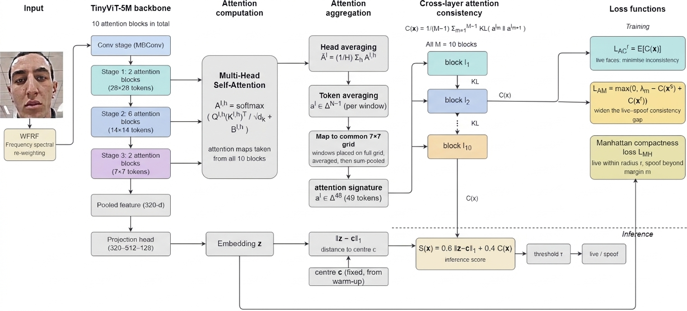
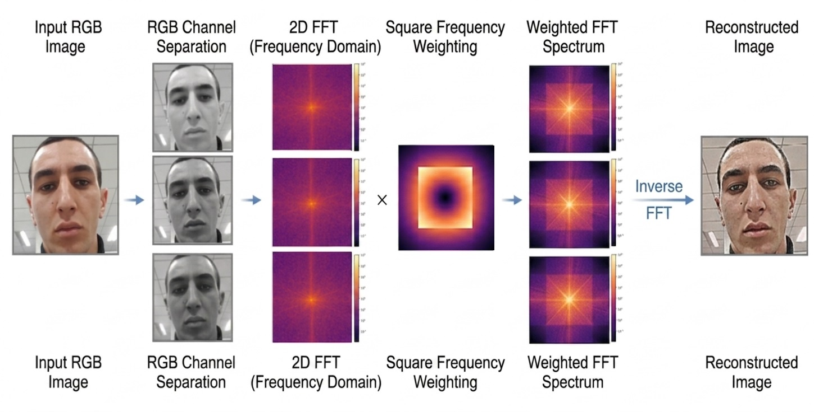

# AC-FAS: Attention Consistency for Semi-Supervised One-Class Face Anti-Spoofing

**Status:** Under review (IEEE Transactions on Biometrics, Behavior, and Identity Science).


## Abstract

Face anti-spoofing (FAS) is essential for the secure deployment of face
recognition (FR) systems, particularly in high-stakes applications.
However, most existing methods formulate FAS as a closed-set binary
classification problem, which limits their ability to generalise to unseen
attack types in shifting domains. In this paper, we propose Attention
Consistency for Face Anti-Spoofing (AC-FAS), a principled semi-supervised
one-class anomaly detection framework that reframes FAS by modelling the
intrinsic normality of live faces, optionally incorporating limited spoof
supervision to sharpen the decision boundary. Our approach is motivated by
the hypothesis that live faces exhibit lower cross-layer attention
divergence than spoof faces, a pattern independently observed in adjacent
domains such as generalisable synthetic-image detection, reflecting a
smoother evolution of spatial attention through the network. AC-FAS
leverages this finding by enforcing cross-layer attention consistency as a
domain-agnostic liveness feature. To further enhance robustness, we
introduce Weighted Frequency Response Filtering (WFRF), a Fourier-based
mechanism applied as both deterministic preprocessing and stochastic
augmentation to suppress domain-sensitive low frequencies while amplifying
high-frequency spoofing patterns. Furthermore, we employ a Manhattan
(L1-norm) Compactness Loss to optimise the feature space, which provides
superior robustness to outliers and ensures strict alignment between the
training objective and our parameter-free inference anomaly score.
Extensive experiments on multiple benchmarks, including OULU-NPU, SiW-Mv2,
and WMCA, demonstrate that AC-FAS consistently outperforms state-of-the-art
methods across intra-domain and leave-one-attack-out (LOAO) protocols,
including a combined cross-domain LOAO setting, effectively detecting both
known and novel presentation attacks. Notably, AC-FAS achieves an ACER of
0.30% on OULU-NPU and reduces the average HTER by approximately 35% over
the strongest competing method under the most challenging cross-domain
protocol, whilst maintaining an AUC of 97.47% on the SiW-Mv2
leave-one-attack-out benchmark.

## Method Overview

<p align="center">
  
</p>
<p align="center">
  <em>Figure 1. Overview of the AC-FAS framework.</em>
</p>

AC-FAS reframes face anti-spoofing as **semi-supervised one-class anomaly
detection**: it models the normality of *live* faces, optionally using a
limited set of labelled spoof samples to sharpen the boundary. Three
components:

1. **WFRF (Weighted Frequency Response Filtering)**: a Fourier-domain
   reweighting of the input image using a square (Chebyshev-distance)
   mask, applied dually as deterministic preprocessing (fixed weights) and
   stochastic training-time augmentation (randomly resampled weights);
   see Figure 2.
2. **Cross-layer Attention Consistency**: the attention signatures of all
   ten transformer blocks of TinyViT-5M are mapped to a common 7×7 grid,
   and the mean KL divergence between consecutive blocks, `C(x)`, is used
   as a liveness signal. Live faces are regularised toward low divergence
   (`L_AC^r`), and a margin loss (`L_AM`) widens the gap between live and
   spoof consistency scores.
3. **Manhattan (L1-norm) Compactness Loss**: live embeddings are pulled
   within an L1 ball of radius `r` around a fixed center `c` (computed via
   a warm-up pass); spoof embeddings are pushed beyond margin `m`.

At inference, the anomaly score is
`S(x) = alpha_s * ||z~(x) - c||_1 + beta_s * C(x)`, thresholded against a
value `tau` (the 95th percentile of the scores of a real-only validation
set), so no spoof labels are needed for calibration.

### Weighted Frequency Response Filtering (WFRF)

<p align="center">
  
</p>
<p align="center">
  <em>Figure 2. The WFRF pipeline: the image is transformed to the frequency domain, reweighted with the Chebyshev-distance mask, and reconstructed with the inverse Fourier transform.</em>
</p>

## Repository Structure

```
AC-FAS_fPAD/
├── README.md
├── requirements.txt
├── .gitignore
├── src/
│   ├── wfrf.py          # Weighted Frequency Response Filtering (deterministic / stochastic)
│   ├── model.py         # TinyViT-5M backbone, projection head, attention-map capture and signatures
│   ├── losses.py        # Manhattan compactness loss, warm-up centre, attention consistency / margin losses
│   ├── dataset.py       # Folder-based real/spoof dataset loading
│   ├── train.py         # Training script (Algorithm 1)
│   └── evaluate.py      # Anomaly score, threshold selection, APCER/BPCER/ACER/HTER/AUC
├── data/README.md
├── results/README.md
└── images/
    ├── AC-FAS-Overview.jpg   # Figure 1
    └── WFRF.jpg              # Figure 2
```

No `argparse` is used anywhere: every script has a `CONFIG` block near the
top; edit the paths/hyperparameters directly and run the file.

## Installation

```bash
git clone https://github.com/RZASHFUOH24-Research/AC-FAS_fPAD.git
cd AC-FAS_fPAD
python -m venv .venv
source .venv/bin/activate      # Windows: .venv\Scripts\activate
pip install -r requirements.txt
```

## Data Preparation

Each split is a plain folder of face images (sub-folders are allowed):

```
Train_Real/    Train_Spoof/     # training
Val_Real/                       # real faces only, used to select tau
Test_Real/     Test_Spoof/      # testing
```

Labels are assigned by folder (1 = live, 0 = spoof). The validation folder
must be disjoint from the test folders.

## Usage

1. Edit the `CONFIG` block at the top of `src/train.py` (dataset folders,
   `SAVE_DIR`, `SEED`) and run:
   ```bash
   python src/train.py
   ```
   A checkpoint (model weights and the fixed centre `c`) is saved after
   every epoch. The reported results use the final checkpoint (epoch 100)
   and are averaged over five runs with different seeds.
   For the strict one-class variant (live faces only), set
   `TRAIN_FOLDER_SPOOF = []`; all spoof-dependent terms are then removed.
2. Edit the `CONFIG` block at the top of `src/evaluate.py` (checkpoint
   path, validation and test folders) and run:
   ```bash
   python src/evaluate.py
   ```

## Hyperparameters

| Symbol | Value | Meaning |
|---|---|---|
| Backbone | TinyViT-5M (ImageNet pre-trained), input 224×224 | `d=320` pooled feature → projection head → `p=128` |
| Projection head | 320 → 512 → 128 | BatchNorm, ReLU, Dropout (0.4), LayerNorm on the output |
| `r` | 2.0 | live compactness radius |
| `m` | 20.0 | spoof separation margin |
| `lambda_l`, `lambda_s` | 1.0, 1.0 | live/spoof term weights in `L_MH` |
| `alpha` | 0 → 0.5 (ramp, epochs 10-20) | weight on `L_AC^r` |
| `beta` | 0.3 (fixed from epoch 1) | weight on `L_AM` |
| `lambda_m` | 2.0 | margin in `L_AM` |
| `alpha_s`, `beta_s` | 0.6, 0.4 | inference score weights |
| `tau` | 95th percentile | of `S(x)` on the real-only validation set |
| `p_aug` | 0.5 | probability of WFRF stochastic-augmentation mode per batch |
| WFRF deterministic | `w_low=0.8`, `w_high=1.75` | used in training, warm-up and inference |
| WFRF stochastic range | `U(0.5, 2.0)` | independently resampled `w_low`, `w_high` per batch |
| Optimiser | Adam, lr `1e-4`, step ×0.1 at epochs 60, 85 | 100 epochs, batch size 16, gradient-norm clipping at 1.0 |

## Implementation Notes

- **Attention capture.** TinyViT's fused attention path never materialises
  the attention weights, so each attention module's `forward` is replaced
  by an equivalent explicit implementation that also stores the
  post-softmax weights. The model's outputs and parameters are unchanged.
  The captured maps are not detached, so `L_AC^r` and `L_AM` train the
  backbone.
- **Blocks of different resolution.** The three transformer stages work on
  28×28, 14×14 and 7×7 token grids (the first with windowed attention).
  Each block's signature is placed back on its full grid and sum-pooled to
  7×7, so every KL term compares two distributions over the same 49 cells.
- **Warm-up centre.** `c` is the mean projected embedding of the real
  training samples, computed once in evaluation mode with deterministic
  WFRF and no parameter updates, and then kept fixed.

## Citation

```bibtex
@article{acfas_under_review,
  author  = {Sheikhfathollahi, Mohammadreza and Parkinson, Simon and Khan, Saad},
  title   = {{AC-FAS}: Attention Consistency for Semi-Supervised One-Class Face Anti-Spoofing},
  journal = {IEEE Transactions on Biometrics, Behavior, and Identity Science},
  note    = {Under review},
  year    = {2026}
}
```
